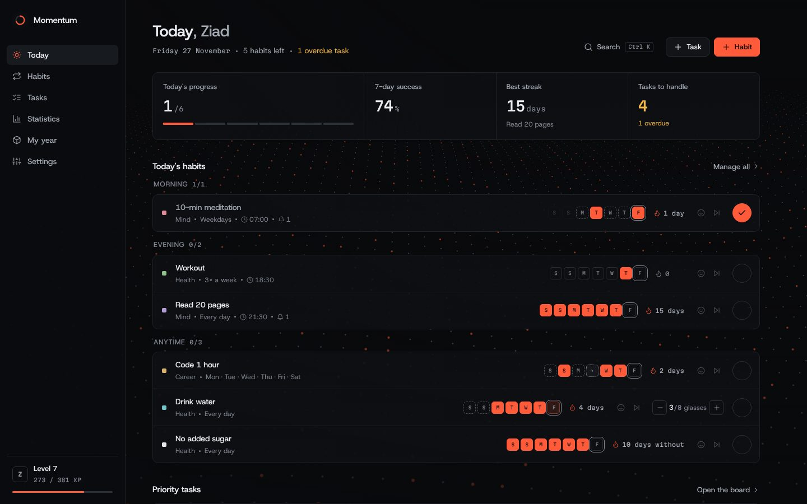
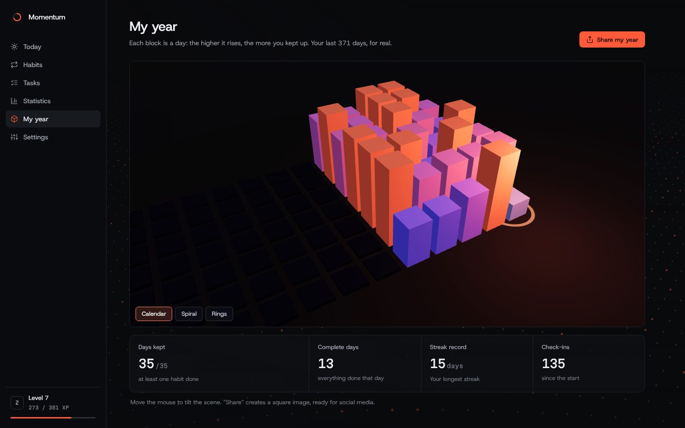
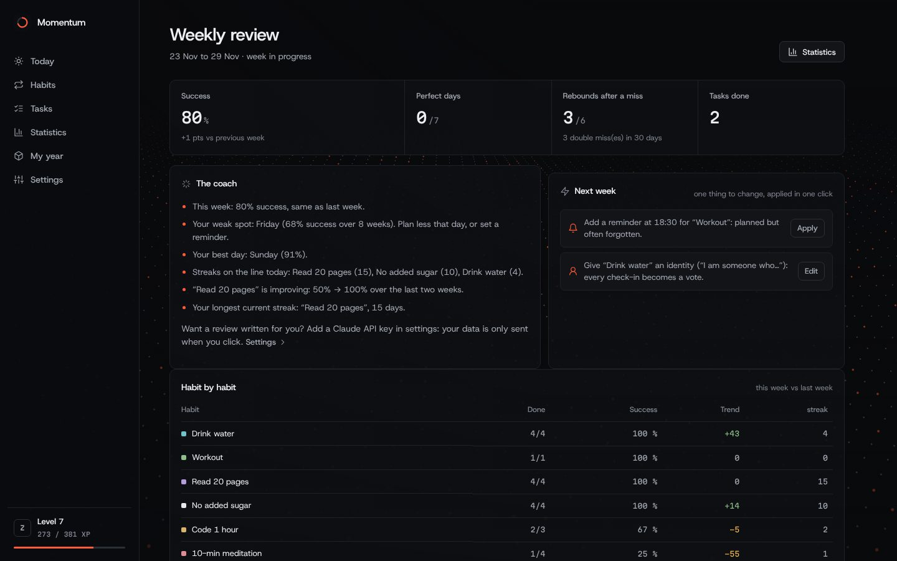
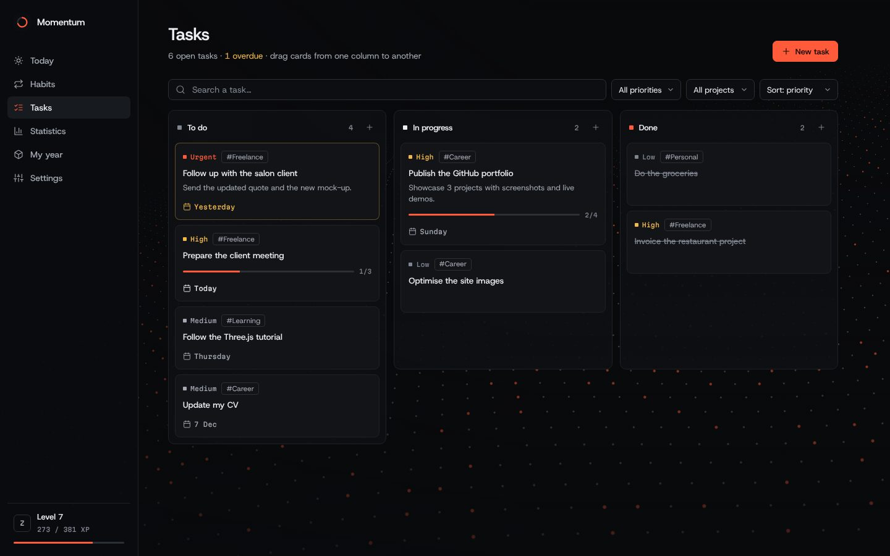
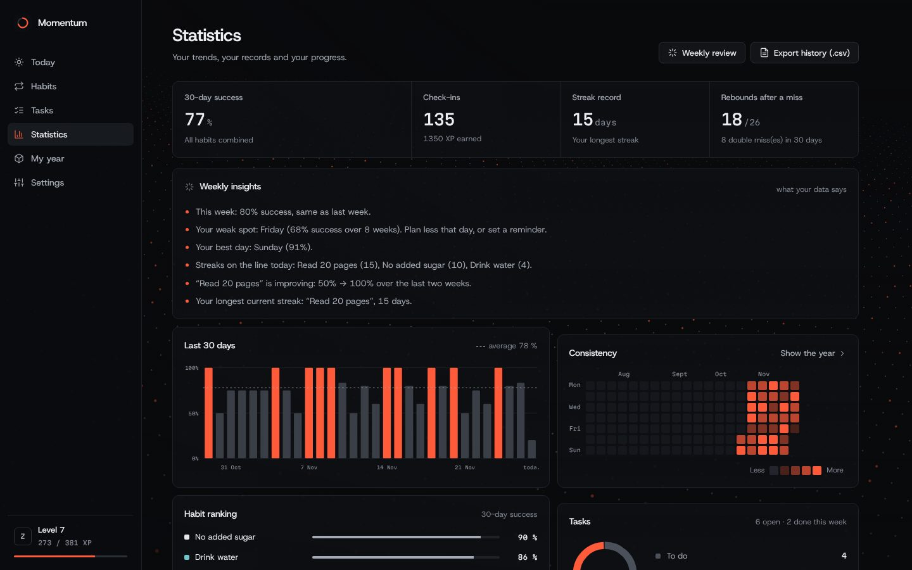

# Momentum · Habitudes & tâches

**Momentum** est une application web installable (PWA) pour suivre ses habitudes, organiser ses tâches et visualiser ses progrès, dans une interface minimaliste (sombre ou claire) avec un **fond animé**. Sans compte, sans serveur : vos données restent sur votre appareil.

👉 **Page vitrine :** https://elalamiz605-tech.github.io/suivi-habitudes/
👉 **Application :** https://elalamiz605-tech.github.io/suivi-habitudes/app.html



## Fonctionnalités

### 🧊 Ce que les autres n'ont pas
- **Mon année en 3D** : vos 371 derniers jours en blocs, un par jour, dans l'application (calendrier, spirale, anneaux). Un bouton **« Partager mon année »** génère une image carrée prête pour les réseaux.
- **Bilan de la semaine** : chaque dimanche, une page qui raconte la semaine en phrases (ce qui a marché, ce qui a coincé), habitude par habitude, avec **une seule chose à changer, applicable en un clic** (passer à 3×/semaine, ajouter un rappel, retirer un jour faible, monter l'objectif). En option, un **coach IA** (clé API Claude, stockée dans le navigateur, données envoyées uniquement au clic) rédige le bilan.
- **« Jamais deux fois »** : après un raté, l'habitude passe en mode reprise avec une **version mini** (la moitié de l'objectif) pour ne pas rater deux fois de suite. Chaque habitude peut porter une **identité** (« je suis quelqu'un qui lit ») et chaque validation devient un vote ; les rebonds après un raté sont comptés et récompensés.

### 📱 Application installable, hors ligne
- **PWA** : installation sur l'écran d'accueil (Android, iOS, ordinateur), plein écran, raccourcis vers chaque page.
- **Mode hors ligne** complet grâce à un service worker (réseau d'abord, cache en secours) ; mise à jour proposée quand une nouvelle version est publiée.
- **Thème sombre, clair ou automatique**, et interface en **anglais par défaut, français ou español** (changeable dans les réglages, choix conservé).

### 🔁 Habitudes
- **Trois types de suivi** : fait / pas fait, **objectif chiffré** (8 verres d'eau, 20 pages…) ou **mauvaise habitude à arrêter** (compteur de « jours sans »).
- **Cinq fréquences** : tous les jours, certains jours, **X fois par semaine**, **tous les X jours**, **X fois par mois**.
- **Bibliothèque de modèles** pour créer une habitude en un clic (eau, méditation, lecture, sport, langue, sans sucre, sans écran…).
- **Passer un jour** sans casser la série, **mettre une habitude en pause**, **mode vacances** global : les jours neutralisés ne comptent ni comme réussis ni comme manqués.
- **Début de journée personnalisable** (minuit → 6 h) pour les couche-tard.
- **Rappels** : jusqu'à 3 heures de rappel par habitude + récapitulatif du soir, par notification (via le service worker).
- **Note et humeur du jour** sur chaque validation ; **minuteur** intégré pour les habitudes en minutes (le temps écoulé est ajouté automatiquement) et minuteur de concentration (25 min).
- Page Aujourd'hui **regroupée par moment de la journée** (matin, après-midi, soir).
- Séries (en cours et record) qui tiennent compte des jours non prévus ; historique sur 14 jours modifiable d'un clic ; catégories, couleur, notes, archivage.

### ✅ Tâches
- **Tableau Kanban** (À faire / En cours / Terminé) avec **glisser-déposer**.
- 4 niveaux de **priorité**, **échéances** (en retard, aujourd'hui, demain…), **projets**, **sous-tâches** avec barre de progression.
- Recherche instantanée, filtres par priorité et projet, trois modes de tri.

### 📊 Statistiques et motivation
- **Analyse de la semaine** : tendance par rapport à la semaine précédente, jour le plus faible / le plus fort, séries en jeu aujourd'hui, habitude en difficulté ou en progrès, lien entre humeur et réussite.
- Taux de réussite sur 30 jours (graphique en barres), **carte de régularité sur 20 semaines ou 12 mois**, classement des habitudes, répartition des tâches, humeur moyenne.
- **XP et niveaux**, **14 badges** à débloquer (séries de 7, 30 et 100 jours, journée parfaite, 100 validations, 7 notes, 5 rebonds, 10 votes…).
- **Export CSV** de tout l'historique (date, habitude, valeur, humeur, note).

### ☁️ Compte Momentum Cloud (optionnel)
- Connectez-vous depuis les réglages pour **synchroniser vos appareils** : à la première connexion, les données du compte sont prises (avec confirmation si l'appareil a déjà des validations), puis chaque changement est envoyé automatiquement et les conflits entre appareils se règlent par la version la plus récente.
- **Rappels push appli fermée** (iPhone compris une fois installée) : chaque appareil s'abonne, le serveur envoie les rappels et le récap du soir à la bonne heure dans votre fuseau.
- **Défi à deux** : un code d'invitation à 6 caractères lie deux comptes ; chacun voit la journée de l'autre (fait/total, journée complète, meilleure série) sur la page Aujourd'hui, rien de plus.
- **Coach IA sans clé** : quand le serveur en a une, le bilan est rédigé côté serveur.
- Serveur : [momentum-cloud](https://github.com/elalamiz605-tech/momentum-cloud) (Node.js, Express, PostgreSQL). L'adresse du serveur est modifiable dans les réglages pour l'héberger soi-même. Les clés locales (gist, Claude) ne quittent jamais l'appareil.

### 💾 Sauvegarde et synchronisation (sans compte)
- **Export / import JSON**, **partage** de la sauvegarde (Web Share sur mobile).
- **Code de transfert** compressé à coller dans Momentum sur un autre appareil.
- **Copies automatiques** quotidiennes (7 derniers jours) restaurables en un clic.
- **Synchronisation optionnelle par gist GitHub** (jeton personnel à permission « gist ») : envoi, récupération, ou synchro automatique entre appareils.

### ⚡ Confort
- **Palette de commandes** `Ctrl + K` : navigation, création, minuteur, thème, mode vacances, recherche d'habitudes et de tâches.
- Raccourcis : `N` nouvelle habitude, `T` nouvelle tâche, `1` à `5` pour changer de page.
- Annulation après suppression, archivage, pause ou jour passé.
- Respecte le réglage « réduire les animations » du système. Le fond animé se met en pause quand l'onglet est caché et peut être désactivé.

| Mon année | Bilan de la semaine |
| --- | --- |
|  |  |

| Tâches | Statistiques |
| --- | --- |
|  |  |

## Lancer le projet

Le projet utilise des modules JavaScript et un service worker : il faut l'ouvrir via un petit serveur local (un double-clic sur `index.html` ou `app.html` ne suffit pas).

```bash
python3 -m http.server 8000
```

Puis ouvrez http://localhost:8000. Vous pouvez aussi utiliser l'extension **Live Server** de VS Code.

## Mise en ligne

Le workflow `.github/workflows/pages.yml` publie le site sur **GitHub Pages** à chaque `push` sur `main`.
Pour l'activer une fois : **Settings → Pages → Source : « GitHub Actions »**.

À chaque publication, pensez à incrémenter `VERSION` dans `sw.js` pour que les utilisateurs reçoivent la nouvelle version (une notification « Recharger » leur est proposée).

## Limites connues

- Sans compte, les **rappels** sont envoyés par la page ou l'application installée (ordinateur et Android en arrière-plan ; iOS doit être ouvert). Avec un compte Momentum Cloud, ce sont de vraies notifications push, appli fermée, iPhone compris une fois installée sur l'écran d'accueil.
- La **synchronisation** repose sur un gist privé GitHub : le jeton reste dans le navigateur, à n'utiliser que sur vos propres appareils.

## Technologies

- HTML, CSS et JavaScript natifs (modules ES), **sans framework ni étape de build**
- [Three.js](https://threejs.org/) r170 (fourni dans `vendor/`) et shaders GLSL écrits à la main
- Graphiques en SVG faits maison, service worker, Web App Manifest, Notifications API, CompressionStream, Web Share
- `localStorage` pour la sauvegarde

## Structure

```
index.html            → page vitrine (scène 3D de l'année + démo)
app.html              → l'application
manifest.webmanifest  → manifeste PWA (icônes, raccourcis)
sw.js                 → service worker (hors ligne, notifications)
css/styles.css        → design (thème sombre et clair, responsive)
js/main.js            → navigation, actions, récompenses, palette de commandes, réglages
js/views.js           → rendu de chaque page
js/forms.js           → fenêtres : habitude (modèles, rappels), tâche, note du jour, minuteur
js/logic.js           → règles : fréquences, jours passés / pauses / vacances, séries, taux, XP, badges
js/insights.js        → analyse et bilan de la semaine, suggestions applicables
js/coach.js           → coach IA optionnel (API Claude, depuis le navigateur)
js/reminders.js       → rappels et notifications
js/backup.js          → export / import, CSV, code de transfert, copies automatiques, synchro gist
js/pwa.js             → installation et mises à jour
js/i18n.js            → traductions fr / es / en
js/store.js           → données, sauvegarde, démo
js/scene.js           → fond animé (vagues sur canvas 2D)
js/year.js            → scène 3D de l'année (vitrine et page « Mon année », image à partager)
js/ui.js              → notifications à l'écran
vendor/               → Three.js
```

## Idées pour la suite

- [ ] Widgets d'écran d'accueil (nécessite une application native)
