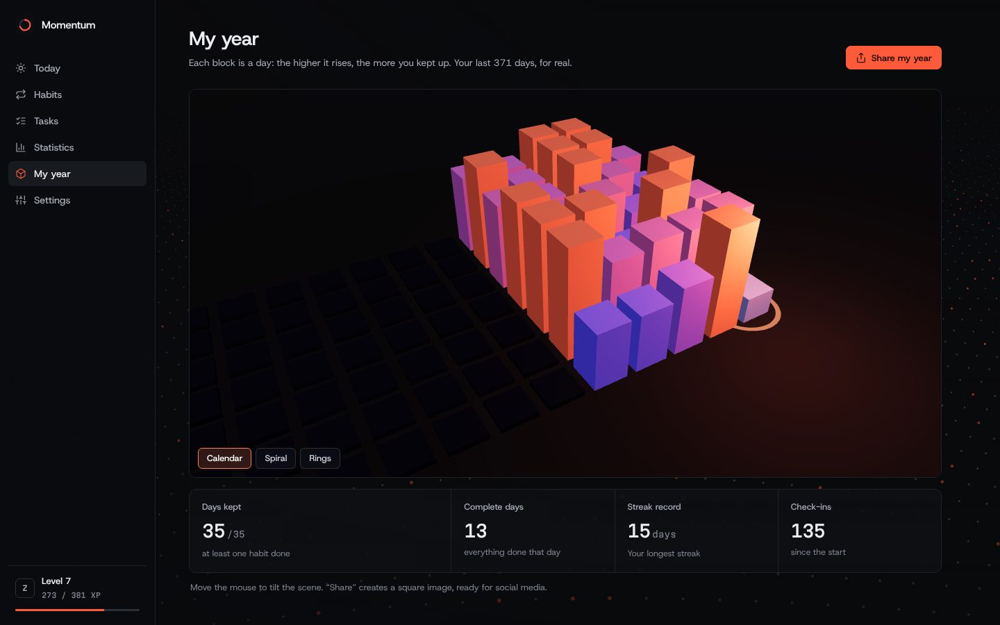
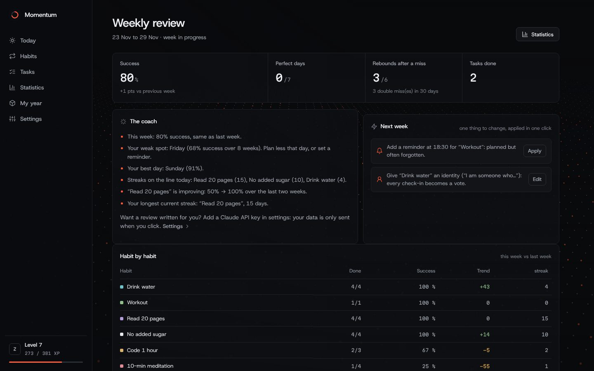
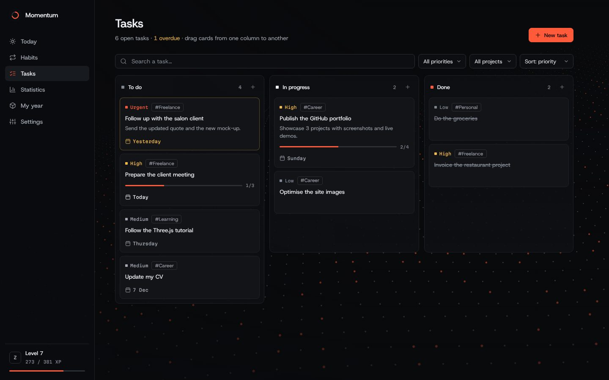
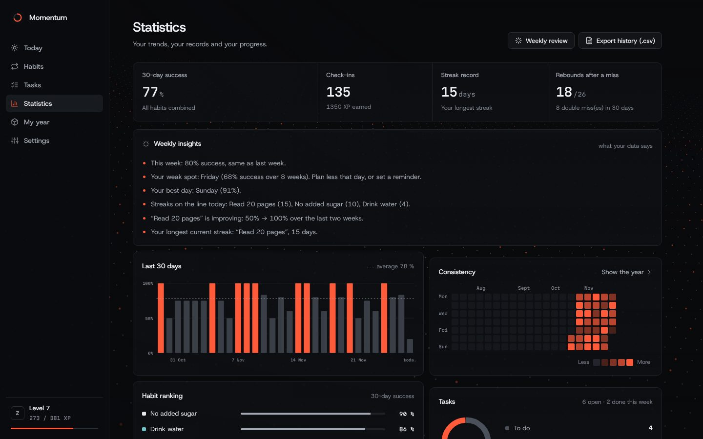

# Momentum · Habits & tasks

*[Version française](README.fr.md)*

**Momentum** is an installable web app (PWA) to track your habits, organise your tasks and see your progress, in a minimalist interface (dark or light) with an **animated background**. No account, no server: your data stays on your device.

👉 **Landing page:** https://elalamiz605-tech.github.io/suivi-habitudes/
👉 **App:** https://elalamiz605-tech.github.io/suivi-habitudes/app.html


## Features

### 🧊 What the others don't have
- **My year in 3D**: your last 371 days as blocks, one per day, inside the app (calendar, spiral, rings). A **"Share my year"** button generates a square image ready for social media.
- **Weekly review**: every Sunday, a page that tells the week in sentences (what worked, what got stuck), habit by habit, with **one thing to change, applied in one click** (switch to 3×/week, add a reminder, drop a weak day, raise the goal). Optionally, an **AI coach** (Claude API key stored in the browser, data sent only on click) writes the review.
- **"Never twice"**: after a miss, the habit enters comeback mode with a **mini version** (half the goal) so you never miss twice in a row. Each habit can carry an **identity** ("I am someone who reads") and every check-in becomes a vote; rebounds after a miss are counted and rewarded.

### 📱 Installable, offline
- **PWA**: install on the home screen (Android, iOS, desktop), full screen, shortcuts to each page.
- Full **offline mode** through a service worker (network first, cache fallback); an update prompt appears when a new version is published.
- **Dark, light or automatic theme**, interface in **English by default, Spanish or French** (switchable in Settings, choice remembered).

### 🔁 Habits
- **Three tracking types**: done / not done, **numeric goal** (8 glasses of water, 20 pages…) or **bad habit to quit** ("days without" counter).
- **Five frequencies**: every day, specific days, **X times a week**, **every X days**, **X times a month**.
- **Templates library** to create a habit in one click (water, meditation, reading, workout, language, no sugar, no screens…).
- **Skip a day** without breaking the streak, **pause a habit**, global **vacation mode**: neutralised days count neither as done nor as missed.
- **Custom day start** (midnight → 6 am) for night owls.
- **Reminders**: up to 3 reminder times per habit + evening recap, by notification; with an account, real push notifications even when the app is closed.
- **Daily note and mood** on every check-in; built-in **timer** for minute-based habits (elapsed time is added automatically) and a focus timer (25 min).
- Today page **grouped by time of day** (morning, afternoon, evening).
- Streaks (current and best) that respect unscheduled days; 14-day editable history; categories, colour, notes, archive.

### ✅ Tasks
- **Kanban board** (To do / Doing / Done) with **drag and drop**.
- 4 **priority** levels, **due dates** (overdue, today, tomorrow…), **projects**, **subtasks** with progress bar.
- Instant search, filters by priority and project, three sort modes.

### 📊 Statistics and motivation
- **Weekly insights**: trend versus last week, weakest / strongest weekday, streaks on the line today, struggling or improving habit, link between mood and success.
- 30-day success rate (bar chart), **consistency map over 20 weeks or 12 months**, habit ranking, task breakdown, average mood.
- **XP and levels**, **14 badges** to unlock (7-, 30- and 100-day streaks, perfect day, 100 check-ins, 7 notes, 5 rebounds, 10 votes…).
- **CSV export** of the whole history (date, habit, value, mood, note).

### ☁️ Momentum Cloud account (optional)
- Sign in from Settings to **sync across devices**: the account's data wins at first sign-in (with confirmation if this device already has check-ins), then every change is pushed automatically and conflicts between devices are resolved by the most recent version.
- **Push reminders with the app closed** (iPhone included once installed): each device subscribes, the server sends reminders and the evening recap at the right time in your timezone.
- **Buddy challenge**: a 6-character invite code links two accounts; each sees the other's day (done/total, perfect day, best streak) on the Today page, nothing more.
- **AI coach without a key**: when the server has one, the weekly review is written server-side.
- Server: [momentum-cloud](https://github.com/elalamiz605-tech/momentum-cloud) (Node.js, Express, PostgreSQL). The server address can be changed in Settings to self-host it. Local secrets (gist token, Claude key) never leave the device.

### 💾 Backup and sync (no account)
- **JSON export / import**, **share** the backup (Web Share on mobile).
- Compressed **transfer code** to paste into Momentum on another device.
- Daily **automatic snapshots** (last 7 days), restorable in one click.
- **Optional sync through a GitHub gist** (personal token with the "gist" permission only): push, pull, or automatic sync between devices.

### ⚡ Comfort
- **Command palette** `Ctrl + K`: navigation, creation, timer, theme, vacation mode, habit and task search.
- Shortcuts: `N` new habit, `T` new task, `1` to `6` to switch page.
- Undo after delete, archive, pause or skip.
- Respects the system "reduce motion" setting. The animated background pauses when the tab is hidden and can be turned off.

| My year | Weekly review |
| --- | --- |
|  |  |

| Tasks | Statistics |
| --- | --- |
|  |  |

## Run it locally

The project uses JavaScript modules and a service worker, so it must be served by a small local server (double-clicking `index.html` or `app.html` is not enough).

```bash
python3 -m http.server 8000
```

Then open http://localhost:8000. The **Live Server** extension for VS Code works too.

## Deployment

The `.github/workflows/pages.yml` workflow publishes the site to **GitHub Pages** on every `push` to `main`.
Enable it once: **Settings → Pages → Source: "GitHub Actions"**.

On each release, bump `VERSION` in `sw.js` so users receive the new version (a "Reload" prompt is shown to them).

## Known limits

- Without an account, **reminders** are sent by the page or the installed app (desktop and Android in the background; iOS needs the app open). With a Momentum Cloud account they are real push notifications, app closed, iOS included once installed on the home screen.
- **Sync** relies on a private GitHub gist: the token stays in the browser, use it only on your own devices.

## Tech

- Native HTML, CSS and JavaScript (ES modules), **no framework, no build step**
- [Three.js](https://threejs.org/) r170 (vendored in `vendor/`) and hand-written GLSL shaders
- Home-made SVG charts, service worker, Web App Manifest, Notifications API, CompressionStream, Web Share
- `localStorage` for persistence

## Structure

```
index.html            → landing page (3D year scene + demo)
app.html              → the application
manifest.webmanifest  → PWA manifest (icons, shortcuts)
sw.js                 → service worker (offline, notifications)
css/styles.css        → design (dark and light themes, responsive)
js/main.js            → navigation, actions, rewards, command palette, settings
js/views.js           → rendering of each page
js/forms.js           → dialogs: habit (templates, reminders), task, daily note, timer
js/logic.js           → rules: frequencies, skipped days / pauses / vacations, streaks, rates, XP, badges
js/insights.js        → weekly insights and review, applicable suggestions
js/coach.js           → optional AI coach (Claude API, from the browser)
js/reminders.js       → reminders and notifications
js/backup.js          → export / import, CSV, transfer code, snapshots, gist sync
js/pwa.js             → install and updates
js/i18n.js            → translations en / es / fr
js/store.js           → data, persistence, demo
js/scene.js           → animated background (Three.js point field + shaders)
js/year.js            → 3D year scene (landing page and "My year" page, shareable image)
js/ui.js              → on-screen notifications
vendor/               → Three.js
```

## Ideas for later

- [ ] Home-screen widgets (needs a native app)
