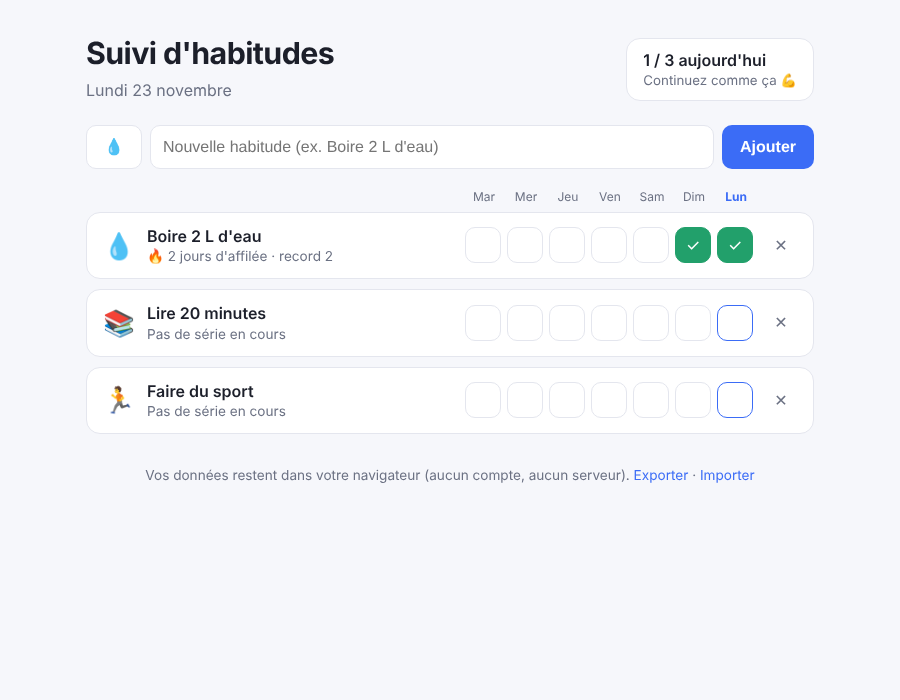

# ✅ Suivi d'habitudes

Une petite application web pour suivre ses habitudes au quotidien (boire de l'eau, lire, faire du sport…) et garder ses **séries de jours réussis** 🔥.



Aucune installation, aucun compte : tout fonctionne dans le navigateur et les données restent sur votre appareil.

## Fonctionnalités

- Ajouter une habitude avec un emoji
- Cocher / décocher les 7 derniers jours d'un clic
- Série en cours et record pour chaque habitude
- Résumé du jour (« 2 / 3 aujourd'hui »)
- Sauvegarde automatique (localStorage)
- Export / import des données en JSON
- Thème sombre automatique et affichage adapté au mobile

## Lancer le projet

Ouvrez simplement `index.html` dans votre navigateur.

Ou, avec un petit serveur local :

```bash
python3 -m http.server 8000
```

puis allez sur http://localhost:8000

## Mettre le site en ligne (gratuit)

Le dépôt contient un workflow GitHub Actions (`.github/workflows/pages.yml`) qui publie le site sur **GitHub Pages** à chaque `push` sur `main`.

1. Sur GitHub : **Settings → Pages → Source : « GitHub Actions »**
2. Faites un `push` : le site sera disponible sur `https://<votre-pseudo>.github.io/<nom-du-depot>/`

## Structure

```
index.html   → la page
style.css    → le design (clair / sombre, mobile)
app.js       → la logique (habitudes, séries, sauvegarde)
.github/     → publication automatique sur GitHub Pages
```

## Idées d'améliorations

- [ ] Statistiques par mois (graphique)
- [ ] Choisir les jours de la semaine pour chaque habitude
- [ ] Notifications de rappel
- [ ] Glisser-déposer pour réordonner les habitudes
- [ ] Installer comme application (PWA)
